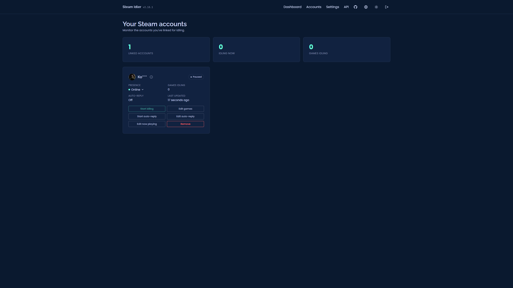
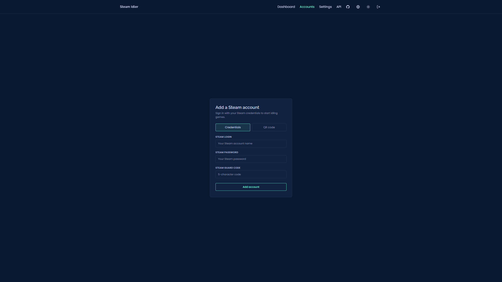
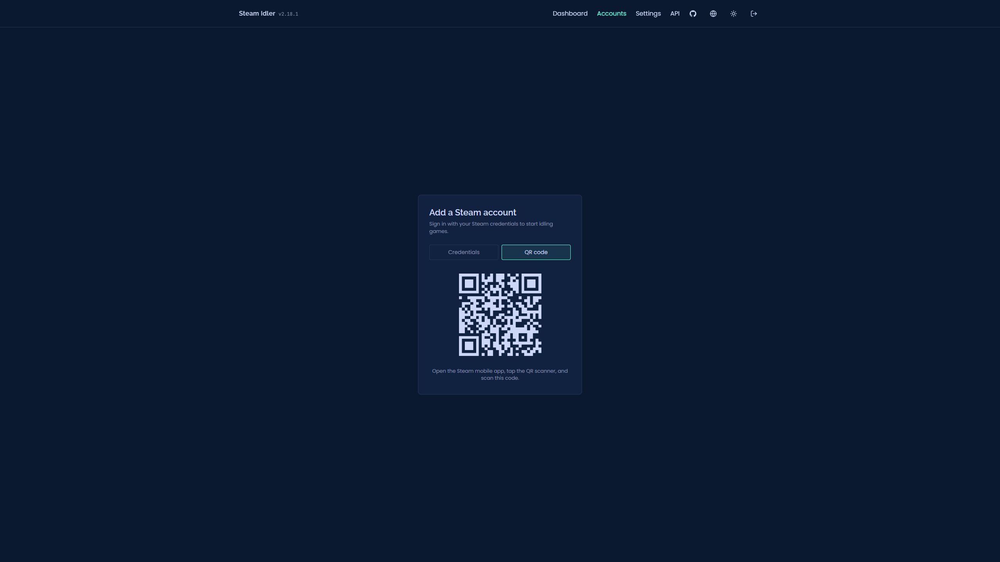
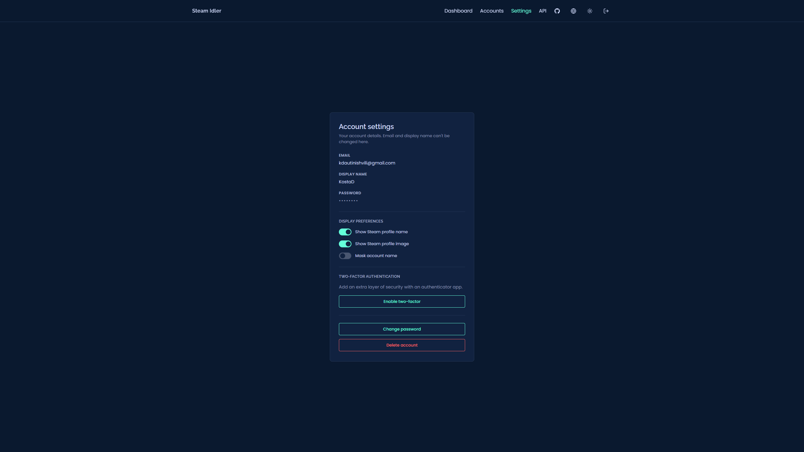
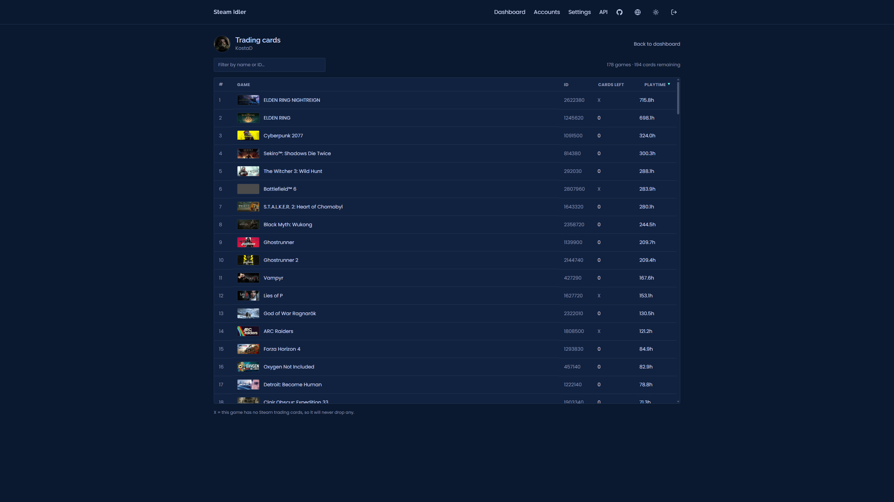
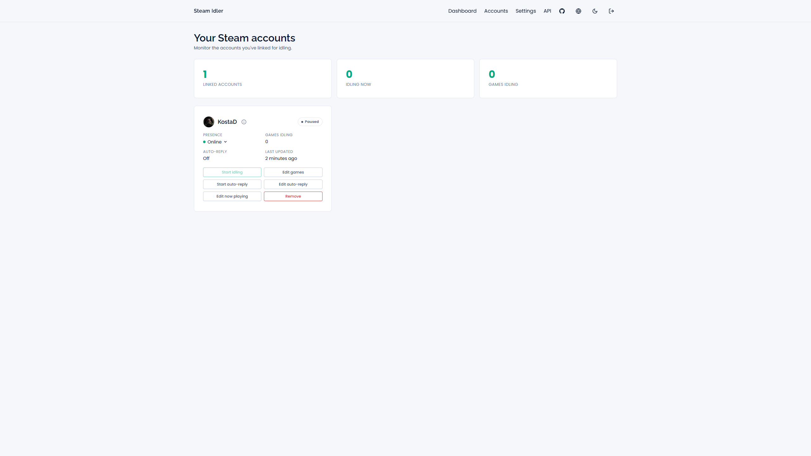
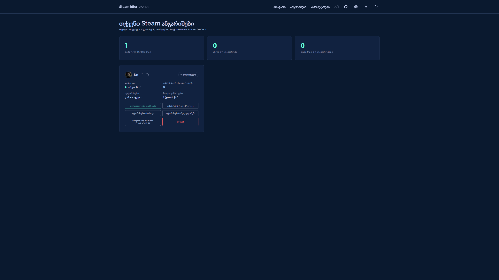
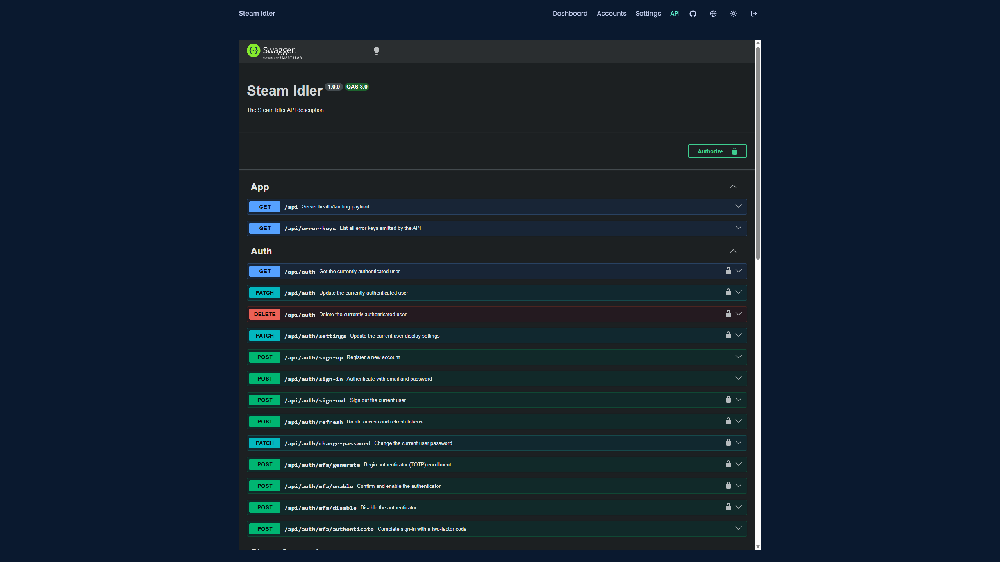

<h1 align="center">Steam Idler</h1>

<p align="center">
  
  <br>
  <em>open-source idling application.</em>
</p>

<p align="center">
  <a href="CONTRIBUTING.md">Contributing Guidelines</a>
  ·
  <a href="https://github.com/KostaD02/steam-idler/issues">Submit an Issue</a>
  <br>
</p>

<p align="center">
  <a href="https://github.com/KostaD02/steam-idler/actions/workflows/ci.yml"></a>
</p>

<h2>Table of contents</h2>

- [Introduction](#introduction)
- [Features](#features)
- [Preview](#preview)
- [Getting started](#getting-started)
  - [Prerequisites](#prerequisites)
  - [How to set up](#how-to-set-up)
  - [Configuration](#configuration)
  - [Reverse proxy and Cloudflare Tunnel](#reverse-proxy-and-cloudflare-tunnel)
- [How does it work](#how-does-it-work)
- [Development](#development)
- [Usage](#usage)
- [Project architecture](#project-architecture)
- [Contributing](#contributing)
- [Issues](#issues)
- [Security and privacy](#security-and-privacy)
- [Logs](#logs)
- [To Do](#to-do)

## Introduction

Steam Idler is a self-hosted application for Steam game idling.
It can idle as many games as you want on as many accounts as you want.
It's great for farming cards or increasing game hours.

The application is built for self-hosting, there is no official hosted instance.
You run it on your own machine and your data stays with you.

This is the second generation of the project, rewritten from scratch.
The previous version is kept at [steam-idler-legacy](https://github.com/KostaD02/steam-idler-legacy) for reference.

## Features

- **Dashboard** - all linked accounts at a glance: idling status, presence, games idling, auto-reply state and last update, with quick actions on every card
- **Parallel idling** - idle multiple games on multiple accounts at the same time
- **Two ways to link a Steam account** - credentials with a Steam Guard code, or scanning a QR code with the Steam mobile app
- **Persona control** - pick the online status the account shows while idling (online, away, invisible and more)
- **Auto-reply** - answer friends who message an idling account with a custom message, optionally only while idling
- **Custom now playing** - show any title as the game you are playing on your friends list
- **Trading cards overview** - remaining card drops and playtime per game, with filtering by name or ID
- **Display preferences** - show or hide the Steam profile name and image, or mask the account name entirely (handy for screenshots and streams)
- **Account security** - optional two-factor authentication (TOTP) with recovery codes, plus password change
- **REST API** - everything the UI does is available over the API, documented with Swagger
- **Translations** - English, ქართული, Español, Deutsch, Português (Brasil), Українська, Türkçe, Français, Polski, Русский, 简体中文. Translations were done with AI, so grammar and wording corrections from native speakers are very welcome, feel free to open a [pull request](https://github.com/KostaD02/steam-idler/pulls)
- **Light and dark theme**
- **Docker support**

## Preview



<details>
<summary><strong>More screenshots</strong></summary>
<br>

|             Add account with credentials             |              Add account by QR code              |
| :--------------------------------------------------: | :----------------------------------------------: |
|  |  |

|      Settings, display preferences and 2FA      |                  Trading cards overview                   |
| :---------------------------------------------: | :-------------------------------------------------------: |
|  |  |

|                     Light theme                      |             Translated UI (ქართული)              |
| :--------------------------------------------------: | :----------------------------------------------: |
|  |  |

|             Swagger API docs              |
| :---------------------------------------: |
|  |

</details>

## Getting started

See instructions to run Steam Idler below.

### Prerequisites

- [Docker](https://www.docker.com/)

That's all you need to run it.
For local development check the [Development](#development) section.

### How to set up

The application can be easily set up using Docker Compose:

```
mkdir steam-idler
cd steam-idler
curl -o docker-compose.yml https://raw.githubusercontent.com/KostaD02/steam-idler/main/docker-compose.yml
curl -o .env https://raw.githubusercontent.com/KostaD02/steam-idler/main/.env.example
```

Generate a secret and paste it into `JWT_SECRET` in `.env`, then repeat for `CREDENTIALS_SECRET`:

```
openssl rand -hex 64
```

No `openssl`? Generate it with the server image instead (it gets downloaded anyway):

```
docker run --rm kostad02/steam-idler-server:latest node -e "console.log(require('crypto').randomBytes(64).toString('hex'))"
```

Then start the application:

```
docker compose up -d
```

That was it, you are ready to use it!
Open `http://<host-ip>:2222` in the browser, other devices work out of the box too since the client automatically points the browser at the API on the same host the page was opened from.

> [!TIP]
> Set `SERVER_IP` in `.env` to force a specific API host, or `API_BASE` to the full API URL. Hosting on a domain? Check [Reverse proxy and Cloudflare Tunnel](#reverse-proxy-and-cloudflare-tunnel).

> [!CAUTION]
> The compose file ships with default secrets so it works out of the box even without a `.env` file.
> If the application is reachable by anyone but you, make sure `JWT_SECRET` and `CREDENTIALS_SECRET` are replaced with generated values as shown above.

### Configuration

Everything in `.env` is optional, the compose file has working defaults.

| Variable                                                     | Default       | Description                                                                                                                                                                    |
| ------------------------------------------------------------ | ------------- | ------------------------------------------------------------------------------------------------------------------------------------------------------------------------------ |
| `SERVER_IP`                                                  | auto          | API host the browser talks to. Empty = auto-detect from the browser's URL. An IP gets `SERVER_PORT` appended, a full domain (e.g. `idler.example.com`) is used without a port. |
| `SERVER_PORT`                                                | `2221`        | Port the API listens on, also used by the Docker port mapping.                                                                                                                 |
| `CLIENT_PORT`                                                | `2222`        | Port the client is served on.                                                                                                                                                  |
| `API_BASE`                                                   | empty         | Full API URL override, wins over everything else. Useful behind a reverse proxy, e.g. `https://idler.example.com/api`.                                                         |
| `SERVER_LOG_TYPE` / `CLIENT_LOG_TYPE`                        | `2`           | Log verbosity: `0` = none, `1` = errors only, `2` = all.                                                                                                                       |
| `JWT_EXPIRES_IN`                                             | `1`           | Session lifetime multiplier for auth cookies.                                                                                                                                  |
| `JWT_SECRET`                                                 | dev default   | Signs auth tokens. Generate your own as shown above.                                                                                                                           |
| `CREDENTIALS_SECRET`                                         | dev default   | Encrypts stored Steam refresh tokens and session cookies. Generate your own as shown above.                                                                                    |
| `DATABASE_URL`                                               | local Mongo   | Only used outside Docker, the compose file wires MongoDB internally.                                                                                                           |
| `REDIS_ENABLED`                                              | `true`        | Set to `false` to use an in-memory cache instead of Redis.                                                                                                                     |
| `REDIS_HOST` / `REDIS_PORT` / `REDIS_PASSWORD` / `REDIS_TTL` | bundled Redis | Cache connection, only relevant outside Docker or with an external Redis. `REDIS_TTL` is in milliseconds.                                                                      |

### Reverse proxy and Cloudflare Tunnel

The recommended way to expose Steam Idler on a domain is a single hostname where `/api` is routed to the server and everything else to the client.
The browser then talks to one origin, so there is no CORS to deal with and access layers like Cloudflare Access keep working.

Example `cloudflared` ingress with the tunnel container attached to the compose network (use `http://localhost:2221` / `http://localhost:2222` instead when `cloudflared` runs on the host):

```yaml
ingress:
  - hostname: idler.example.com
    path: ^/api(/.*)?$
    service: http://steam-idler-server:2221
  - hostname: idler.example.com
    service: http://steam-idler-client:2222
  - service: http_status:404
```

Then point the client at that hostname in `.env` and recreate the client container:

```
SERVER_IP=idler.example.com
```

The same pattern works with any reverse proxy (nginx, Caddy, Traefik): route `/api` by path to the server port and everything else to the client port.

> [!WARNING]
> Avoid a separate hostname for the API (e.g. `api.idler.example.com`) when an authentication layer like Cloudflare Access, Authelia or authentik sits in front of it.
> Browsers send CORS preflight requests without credentials, the auth layer rejects them and every API call fails.
> With the single hostname setup above this problem cannot happen.

## How does it work

The first question might be: Is it safe?
**Yes**, this application uses the [steam-user](https://www.npmjs.com/package/steam-user) and [steam-session](https://www.npmjs.com/package/steam-session) packages, which allow interaction with the Steam API through Node.js.

To start idling for an account, you need to sign it in first. There are two ways:

- Username, password and two-factor authentication code
- Scanning a QR code with the Steam mobile app

After the authorization process, your data will be saved on your machine using MongoDB. This data does not include your **password**.
The following will be saved after authorization:

- `steamId`
- `steamCookies`
- `steamRefreshToken`

Cookies and the refresh token are encrypted with AES-256-GCM using your `CREDENTIALS_SECRET` before they touch the database.
You can review exactly what is stored by checking this [file](./libs/server/steam-account/domain/src/lib/steam-account.schema.ts).
This data is required to prevent the need to log in again whenever the server is stopped or restarted.

> [!CAUTION]
> Since your password is sent during the sign-in process, it is recommended to put the application behind HTTPS in your hosted environment, for example with a [reverse proxy](https://en.wikipedia.org/wiki/Reverse_proxy), a [Cloudflare Tunnel](https://www.cloudflare.com/products/tunnel/) or a similar approach.
> Check [Reverse proxy and Cloudflare Tunnel](#reverse-proxy-and-cloudflare-tunnel) for the recommended setup.

## Development

You will need [Node.js](https://nodejs.org/) 20+, [pnpm](https://pnpm.io/) 9 and [Docker](https://www.docker.com/).

First we need to clone the repository and install packages:

```
git clone https://github.com/KostaD02/steam-idler
cd steam-idler
pnpm install
```

Create a `.env` file from the example and generate the secrets:

```
cp .env.example .env
pnpm g:secret
```

Run `pnpm g:secret` twice and paste the values into `JWT_SECRET` and `CREDENTIALS_SECRET`.

Then start the database containers:

```
pnpm db:up
```

> [!NOTE]
> If you don't want to run Redis, set `REDIS_ENABLED=false` in `.env` and an in-memory cache is used instead.

After that, run the following script in the terminal:

```
pnpm start
```

It serves both applications: client on [http://localhost:2222](http://localhost:2222) and server on [http://localhost:2221/api](http://localhost:2221/api).
Swagger is available at [http://localhost:2221/api/swagger](http://localhost:2221/api/swagger).

To run the whole stack (client, server, MongoDB, Redis) from source with Docker:

```
pnpm docker:local:up
```

## Usage

Just open the browser and type `ip:port` of the machine running Steam Idler (port `2222` by default).
The first registered user becomes the admin.

## Project architecture

The project is an [Nx](https://nx.dev/) monorepo.

- Server side:
  - [NestJS](https://nestjs.com/)
  - [MongoDB](https://www.mongodb.com/)
  - [Redis](https://redis.io/) (optional cache)
- Client side:
  - [Angular](https://angular.dev/)

Applications live in `apps/`, all real code lives in `libs/` split by scope, domain and type.
Check the [contributing page](CONTRIBUTING.md) for the full structure.

## Contributing

I will add new features when I have time, but you don't have to wait, feel free to add them yourself! Fork the project and submit [pull requests](https://github.com/KostaD02/steam-idler/pulls).
Check more details at the [contributing page](CONTRIBUTING.md).

## Issues

If you see any [issues](https://github.com/KostaD02/steam-idler/issues), feel free to open an issue or suggest a [pull request](https://github.com/KostaD02/steam-idler/pulls).

## Security and privacy

Steam Idler is self-hosted, your data stays on your machine and is never sent anywhere else.
Check the [security policy](SECURITY.md) and the [privacy policy](PRIVACY_POLICY.md) for details.

## Logs

When running with Docker, you can easily check what's happening in background processes by running this script:

```
docker logs steam-idler-server --follow
```

Log verbosity is controlled by `SERVER_LOG_TYPE` and `CLIENT_LOG_TYPE` in `.env` (0 = none, 1 = errors only, 2 = all).

## To Do

Here are a few ideas that will be implemented in the future.
You can also open an issue for any of these ideas.

- End-to-end tests
